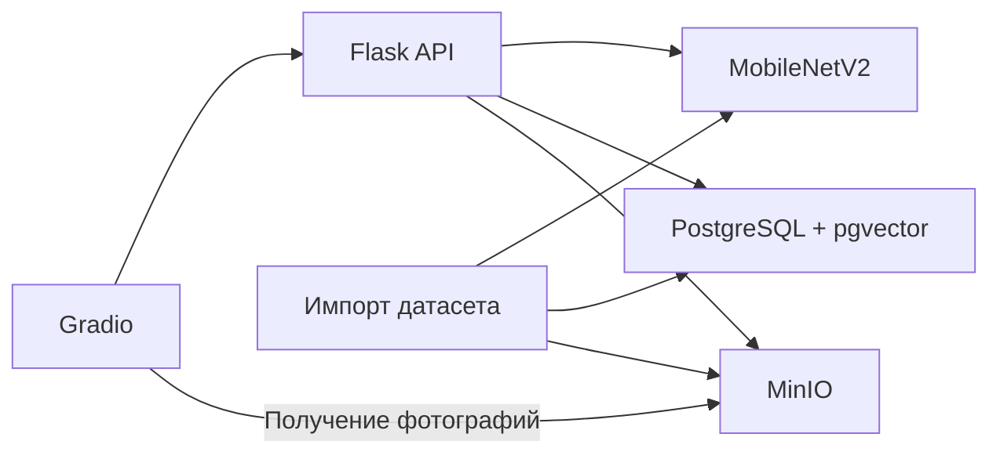

# Поиск похожих котиков

Учебный ML-сервис для поиска визуально похожих фотографий. В интерфейсе Gradio можно загрузить фото для поиска или добавить его в коллекцию. Сервис возвращает до пяти ближайших изображений.

## Быстрый старт

Понадобятся Docker с Compose v2 и `unzip`. Выполните команды из корня репозитория.

```bash
cp -n .env.example .env
unzip -o data/cat_images.zip -d data/
docker compose --profile init run --rm --build init-db
docker compose up --build -d
```

Архив содержит 200 фотографий. При первом вычислении эмбеддингов PyTorch скачает веса MobileNetV2, поэтому контейнерам нужен доступ в интернет. На чистой базе после успешного импорта `GET /stats` вернёт `{"total_images":200}`. Повторный импорт того же архива обновляет записи без дубликатов. Добавленные через интерфейс фотографии сохраняются отдельно.

Откройте Gradio на [localhost:7860](http://localhost:7860). На вкладке **Find Similar Cats** выберите фото и нажмите **Find Similar Cats**. Вкладка **Upload New Cat** добавляет фото в коллекцию.

Для остановки используйте `docker compose down`. Данные PostgreSQL и MinIO хранятся в именованных томах и сохраняются между запусками.

## Как устроен сервис



MobileNetV2 извлекает из каждой фотографии вектор из 1280 чисел. PostgreSQL с pgvector ищет ближайшие векторы по косинусному расстоянию с помощью индекса HNSW. Чем меньше расстояние, тем ближе изображения по признакам модели. Сами фотографии хранятся в MinIO.

## API

Flask доступен на `http://localhost:5001`. Оба POST-запроса принимают файл в поле `image` формата `multipart/form-data`.

| Метод | Путь | Результат |
| --- | --- | --- |
| GET | `/stats` | Количество изображений в коллекции |
| POST | `/similar` | До пяти совпадений с ID, расстоянием и временной ссылкой |
| POST | `/upload` | ID и временная ссылка на добавленное изображение |

```bash
curl --fail-with-body http://localhost:5001/stats
curl --fail-with-body -F 'image=@data/cat_images/cat_0099.jpg' http://localhost:5001/similar
```

В Compose ссылки подписываются для внутреннего адреса `http://minio:9000`. Gradio получает фотографии по этим ссылкам внутри сети Docker и показывает их в браузере.

## Настройки и файлы

- `app/api.py` — HTTP API на Flask.
- `app/ui.py` — интерфейс на Gradio.
- `app/ml_utils.py` — извлечение эмбеддингов MobileNetV2.
- `app/db_utils.py` — работа с PostgreSQL и MinIO.
- `scripts/init_db.py` — импорт фотографий из каталога `DATA_DIR`.
- `.env.example` — пример настроек Compose с демонстрационными паролями. Локальный `.env` игнорируется Git.

Консоль MinIO доступна на [localhost:9001](http://localhost:9001). Для входа используются `MINIO_ROOT_USER` и `MINIO_ROOT_PASSWORD` из `.env`.
